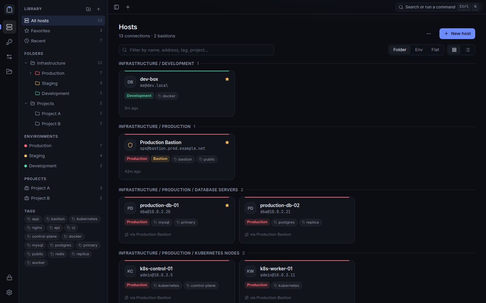
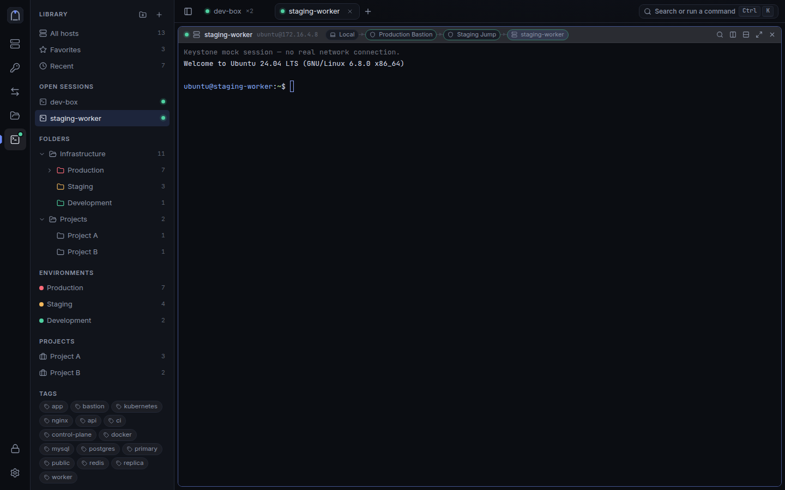
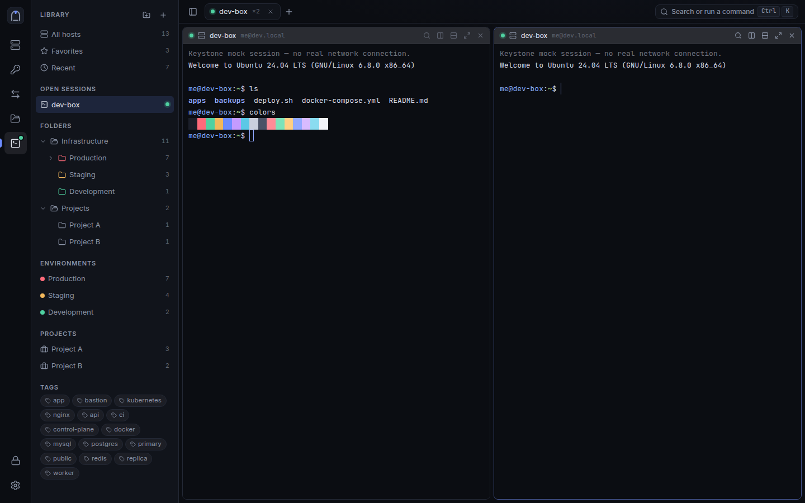
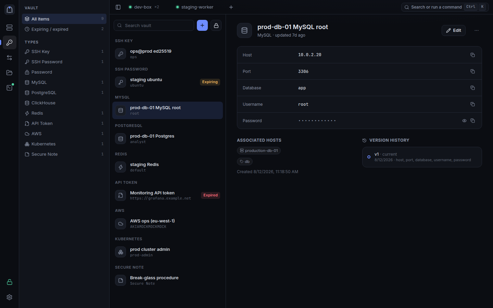
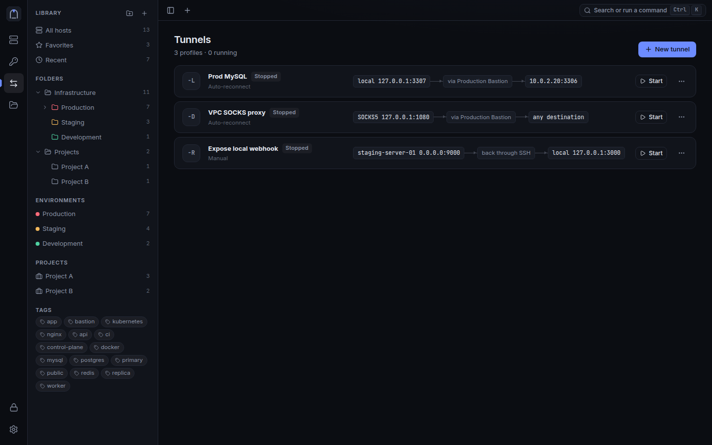
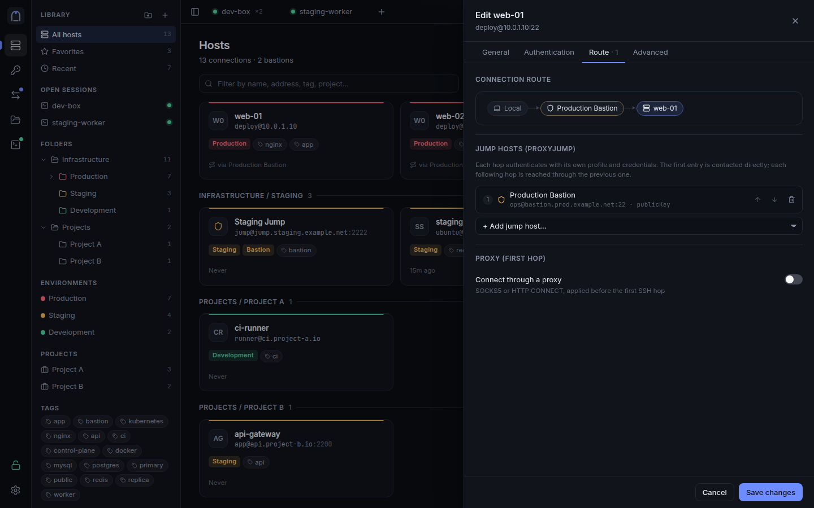
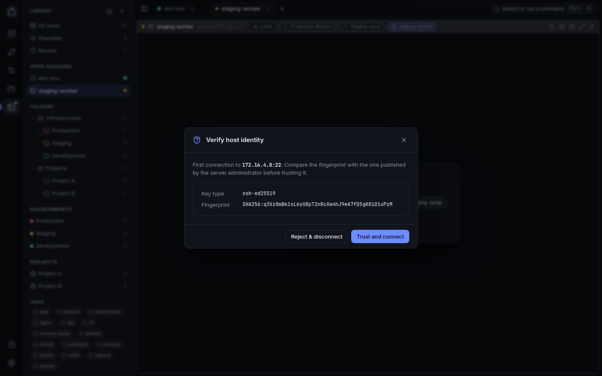
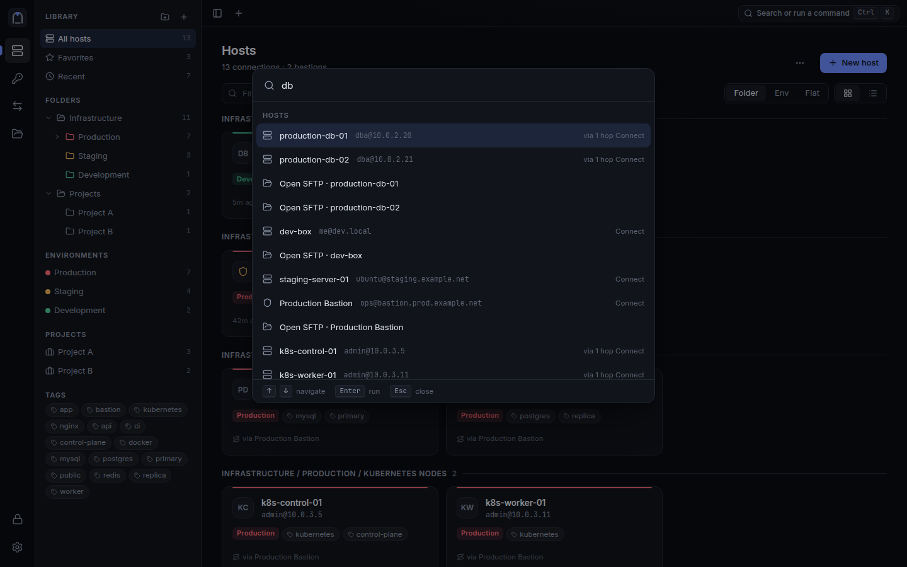
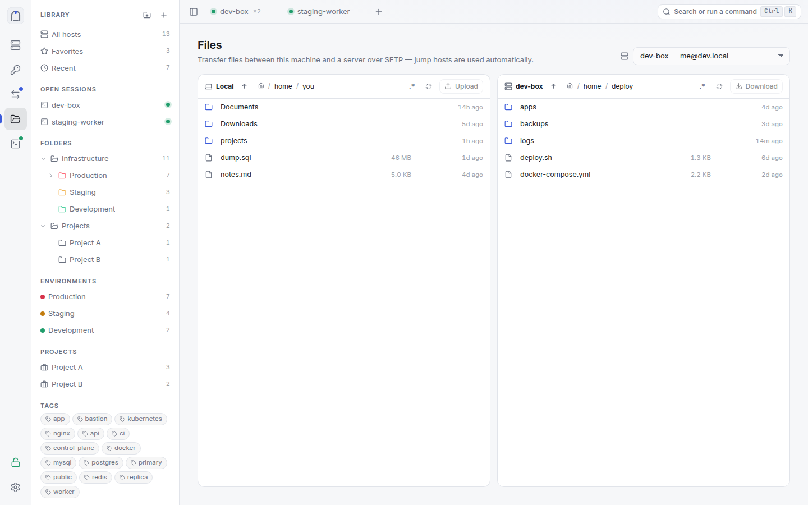
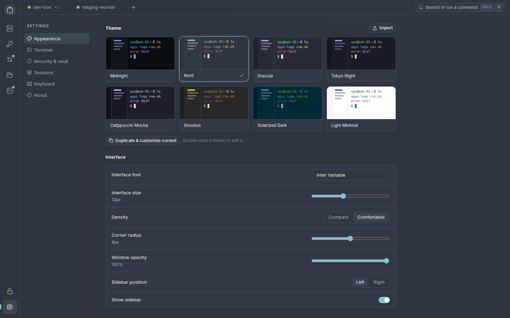

<p align="center">
  
</p>

<h1 align="center">Keystone</h1>

<p align="center">
  SSH and infrastructure management for the desktop: connections, an encrypted credential vault,<br>
  jump-host chains, tunnels and SFTP in one keyboard-driven app.
</p>

<p align="center">
  <a href="https://github.com/Jaimtlearn/KeyStone/actions/workflows/build.yml"></a>
  
  
  
  
</p>

<p align="center">
  
</p>

**Stack:** Tauri 2 · Rust (russh, Argon2id, XChaCha20-Poly1305) · React 18 + TypeScript · xterm.js
**Targets:** Windows 10/11 and Linux. macOS can be added without restructuring (see `docs/ARCHITECTURE.md`).

## Screenshots

> Screenshots show the built-in demo data, not real servers.

<table>
  <tr>
    <td width="50%"><br><sub><b>Terminal through a jump chain:</b> the route (Local → Production Bastion → Staging Jump → target) is shown on the pane</sub></td>
    <td width="50%"><br><sub><b>Tabs and split panes</b></sub></td>
  </tr>
  <tr>
    <td><br><sub><b>Encrypted vault:</b> SSH keys, databases, cloud and API credentials, with expiry and version history</sub></td>
    <td><br><sub><b>Tunnels:</b> <code>-L</code>, <code>-R</code> and SOCKS5 <code>-D</code>, through bastions, with auto-reconnect</sub></td>
  </tr>
  <tr>
    <td><br><sub><b>Route editor:</b> chain jump hosts, each with its own credentials</sub></td>
    <td><br><sub><b>Host-key verification</b> on every hop</sub></td>
  </tr>
  <tr>
    <td><br><sub><b>Ctrl+K command palette:</b> connect, open SFTP, run any action</sub></td>
    <td><br><sub><b>Dual-pane SFTP</b> (light theme)</sub></td>
  </tr>
  <tr>
    <td colspan="2"><br><sub><b>8 built-in themes</b> plus a theme editor (Nord shown)</sub></td>
  </tr>
</table>

## What's in it

| Area | Features |
|---|---|
| **Connections** | Nested folders, environments, projects, tags, favorites, search, duplicate, import/export, `~/.ssh/config` import, multiple profiles per server |
| **Auth** | Password, private key (vault or file, passphrase-protected), ssh-agent / Windows OpenSSH agent, SOCKS5/HTTP proxy for the first hop |
| **Bastions** | Chained jump hosts, each hop with its own credentials, port and host-key check. Bastions can sit behind other bastions. The route is drawn in the UI. Agent forwarding asks for consent on every connection |
| **Terminal** | Tabs, recursive horizontal/vertical splits, rename, search, copy-on-select, fullscreen pane, local shells (ConPTY/openpty), automatic reconnect, workspace restore |
| **Vault** | 11 credential kinds (SSH key/password, MySQL, PostgreSQL, ClickHouse, Redis, API token, AWS, Kubernetes, password, secure note); host associations; reuse by reference; version history and restore; expiry; generator; strength meter; copy with auto-clear; auto-lock; encrypted backups |
| **Tunnels** | `-L`, `-R`, `-D` (SOCKS5), port-conflict detection, live status and traffic, auto-start, auto-reconnect |
| **Files** | Dual-pane local/remote SFTP browser, upload/download with progress, mkdir/rename/delete |
| **UX** | Ctrl+K command palette, global search, context menus, configurable keybindings, 8 built-in themes plus a full theme editor with import/export |

## Getting started

### 1. System prerequisites

**Linux (Debian/Ubuntu)**
```bash
sudo apt install libwebkit2gtk-4.1-dev libgtk-3-dev libsoup-3.0-dev \
  librsvg2-dev libayatana-appindicator3-dev build-essential curl file
```
Fedora: `sudo dnf install webkit2gtk4.1-devel gtk3-devel libsoup3-devel librsvg2-devel`

**Windows** (PowerShell, one time):
```powershell
winget install Microsoft.VisualStudio.2022.BuildTools --override "--quiet --wait --add Microsoft.VisualStudio.Workload.VCTools --includeRecommended"
winget install Rustlang.Rustup OpenJS.NodeJS.LTS Git.Git
```
WebView2 is preinstalled on Windows 10 (recent builds) and 11. No NASM or CMake is needed: SSH crypto uses the `ring` backend.
Build from a normal Windows folder (e.g. `C:\dev\keystone`), **not** from `\\wsl$\...`: building over the WSL file share is very slow and can break file watching.

Both platforms need Rust ≥ 1.88 and Node ≥ 20.

**Without a Windows machine:** push to GitHub and run the `build` workflow (`.github/workflows/build.yml`) to get `.msi`/`.exe` installers as artifacts.

### 2. Run
```bash
npm install          # Tauri CLI
npm run setup        # UI dependencies
npm run dev          # launches the desktop app with hot reload
```

**UI only, in a browser, no Rust:** `npm run dev:ui`, then open http://localhost:1420. This uses a **mock backend** with sample data: nothing connects to real servers and its "local terminal" is fake. Real SSH only works in the desktop app (`npm run dev` or an installed build).

### 3. Test and build
```bash
npm test             # core unit and SSH end-to-end tests, plus UI type-check/build
npm run build        # installers: .deb/.rpm/.AppImage or .msi/.exe
```

## Layout
```
crates/keystone-core/   all security- and network-sensitive logic (no UI deps)
  src/vault.rs            encrypted vault, history, backups
  src/ssh/                jump chains, sessions, tunnels, SFTP, proxies
  tests/ssh_e2e.rs        real SSH servers in-process: bastion → target
src-tauri/              thin Tauri adapter (commands, events, prompts, auto-lock)
ui/                     React app; src/lib/api.ts + types.ts is the IPC contract
docs/ARCHITECTURE.md    how the pieces fit
docs/THREAT_MODEL.md    what is and is NOT protected
docs/VAULT_INTEGRATION.md  plan: using vault credentials in terminals and DB clients
```

## Security at a glance

The master password goes through Argon2id (64 MiB) to unwrap a random vault key. The whole vault is encrypted with XChaCha20-Poly1305, and secrets never reach the webview except on an explicit "reveal". Host keys are verified on every hop, and changed keys are flagged. Read **`docs/THREAT_MODEL.md`** for the limits: in particular, malware running as your user while the vault is unlocked can read secrets from memory, and clipboard history managers may keep copies.

## Status

Not yet implemented (also listed in the threat model):
- OS keychain quick-unlock and Windows Hello
- A monitoring dashboard (`ssh_exec` exists in the backend; the UI doesn't use it yet)
- Recursive folder transfers in SFTP
- Host-key certificate authorities
